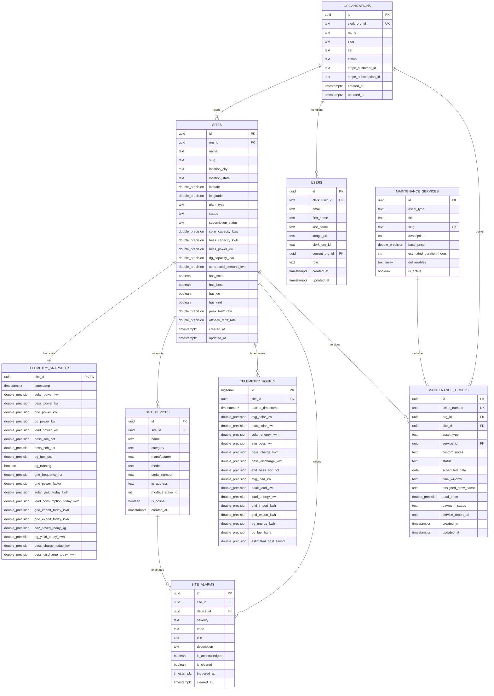

# NEON ENERGY — Existing API Specifications & Database Schema Reference

> **Document Status**: Production Verified  
> **Target Runtime**: Next.js 15+ App Router, Supabase PostgreSQL, Clerk Multi-Tenant Auth  
> **Database Host**: Supabase PostgreSQL (`mzumlzmfjgzvycebqask`)  
> **Base API Path**: `/api/v1`  
> **Last Updated**: October 2026

---

## Table of Contents

1. [Executive Architecture & Multi-Tenancy](#1-executive-architecture--multi-tenancy)
2. [Complete REST API Reference (Request / Response)](#2-complete-rest-api-reference-request--response)
   - [2.1 Fleet & Sites API](#21-fleet--sites-api)
     - `GET /api/v1/sites` — List fleet sites with live telemetry
     - `POST /api/v1/sites` — Register a new Solar & BESS site
     - `GET /api/v1/sites/:id` — Site details, device inventory & latest snapshot
     - `PUT /api/v1/sites/:id` — Update site configuration & tariff settings
   - [2.2 Analytics Engine API](#22-analytics-engine-api)
     - `GET /api/v1/sites/:id/analytics/consumption` — Energy dispatch & historical consumption series
     - `GET /api/v1/sites/:id/analytics/arbitrage` — TOU arbitrage savings & peak demand shaving
   - [2.3 Weather & Solar Irradiance Forecasting API](#23-weather--solar-irradiance-forecasting-api)
     - `GET /api/v1/sites/:id/weather` — Real-time weather, module thermal derating & BESS automation directive
   - [2.4 Maintenance Marketplace API (Solar PV & BESS)](#24-maintenance-marketplace-api-solar-pv--bess)
     - `GET /api/v1/maintenance/services` — List certified Solar PV & BESS service packages
     - `GET /api/v1/maintenance/tickets` — List active & historical maintenance tickets
     - `POST /api/v1/maintenance/tickets` — Book a certified maintenance service window
     - `PATCH /api/v1/maintenance/tickets/:id/status` — Update ticket lifecycle & dispatch status
   - [2.5 Multi-Tenant Organization Invitations API](#25-multi-tenant-organization-invitations-api)
     - `GET /api/v1/org/invite` — Retrieve admin-managed organizations & generated invite links
     - `POST /api/v1/org/invite` — Send Clerk email invitation or generate signed HMAC link
     - `POST /api/v1/org/invite/accept` — Accept invitation token, join org & sync database profile
3. [Client API Callers & UI Invocation Map](#3-client-api-callers--ui-invocation-map)
4. [Supabase PostgreSQL Database Schema Definitions](#4-supabase-postgresql-database-schema-definitions)
   - [4.1 Entity Relationship Diagram (ERD)](#41-entity-relationship-diagram-erd)
   - [4.2 Table: `public.organizations`](#42-table-publicorganizations)
   - [4.3 Table: `public.sites`](#43-table-publicsites)
   - [4.4 Table: `public.site_devices`](#44-table-publicsite_devices)
   - [4.5 Table: `public.telemetry_snapshots`](#45-table-publictelemetry_snapshots)
   - [4.6 Table: `public.telemetry_hourly`](#46-table-publictelemetry_hourly)
   - [4.7 Table: `public.site_alarms`](#47-table-publicsite_alarms)
   - [4.8 Table: `public.maintenance_services`](#48-table-publicmaintenance_services)
   - [4.9 Table: `public.maintenance_tickets`](#49-table-publicmaintenance_tickets)
   - [4.10 Table: `public.users`](#410-table-publicusers)
5. [Row Level Security (RLS) & Access Control Matrix](#5-row-level-security-rls--access-control-matrix)
6. [Database Indexes & Performance Tuning](#6-database-indexes--performance-tuning)

---

## 1. Executive Architecture & Multi-Tenancy

NEON ENERGY utilizes a strict multi-tenant architecture designed for renewable asset owners, EPC contractors, and facility operators:

1. **Authentication & Identity**: Handled exclusively via **Clerk** (`@clerk/nextjs`). Every request made from the frontend includes the user's active session. The server extracts `userId`, `orgId`, and `orgRole` using `@clerk/nextjs/server`.
2. **Tenant Scoping**: All sites, devices, tickets, and telemetry records are partitioned by `org_id` referencing `public.organizations(id)`. When an active organization cannot be resolved directly from the session, it automatically falls back to the user's Clerk organization membership list or the master organization (`org_3JgZ51s2g9LkRRE0L61kAXDGDWE`).
3. **Database Layer**: Hosted on **Supabase PostgreSQL**. Queries are executed via a direct Node.js PostgreSQL connection pool (`pg.Pool` in `lib/supabase/db.ts`) with SSL enforcement and cached global pool lifecycle.
4. **Data Presentation Standard**: All electrical telemetry units conform to standard industrial conventions:
   - Power: Kilowatts ($kW$) or Megawatts ($MW$) formatted in `font-mono`.
   - BESS Sign: **Negative ($-$) = Charging**, **Positive ($+$) = Discharging**.
   - Grid Sign: **Positive ($+$) = Import**, **Negative ($-$) = Export**.

---

## 2. Complete REST API Reference (Request / Response)

### 2.1 Fleet & Sites API

---

#### `GET /api/v1/sites`
- **Source Route**: `app/api/v1/sites/route.ts`
- **Description**: Returns all Solar, BESS, DG, and Grid installations scoped to the caller's Clerk organization, joined with the latest sub-second electrical flow snapshot (`telemetry_snapshots`).
- **Auth**: Clerk session (`auth()`).
- **Query Parameters**:
  | Parameter | Type | Required | Default | Description |
  |---|---|---|---|---|
  | `status` | string | No | `undefined` | Filter sites by status (`online`, `degraded`, `offline`, `maintenance`) |
  | `asset` | string | No | `undefined` | Filter by enabled asset: `'bess'` (`has_bess = true`), `'solar'` (`has_solar = true`), `'dg'` (`has_dg = true`) |
- **Headers**:
  ```http
  Cookie: __session=...
  Accept: application/json
  ```
- **Success Response (`200 OK`)**:
  ```json
  {
    "success": true,
    "count": 3,
    "orgId": "org_3JgZ51s2g9LkRRE0L61kAXDGDWE",
    "data": [
      {
        "id": "e0b82f01-72f5-4dc9-98cf-195b0b2e8112",
        "org_id": "78bcfb5c-b16a-4b06-a2a9-7fa7df474e2a",
        "name": "Bakersfield Central Solar-Plus-Storage",
        "slug": "bakersfield-central",
        "location_city": "Bakersfield",
        "location_state": "CA",
        "latitude": 35.3733,
        "longitude": -119.0187,
        "plant_type": "commercial_industrial",
        "status": "online",
        "subscription_status": "active",
        "solar_capacity_kwp": 940.0,
        "bess_capacity_kwh": 1500.0,
        "bess_power_kw": 500.0,
        "dg_capacity_kva": 0.0,
        "contracted_demand_kva": 800.0,
        "has_solar": true,
        "has_bess": true,
        "has_dg": false,
        "has_grid": true,
        "peak_tariff_rate": 0.18,
        "offpeak_tariff_rate": 0.07,
        "created_at": "2026-09-22T19:50:00.000Z",
        "solar_power_kw": 940.0,
        "live_bess_power_kw": -240.0,
        "grid_power_kw": -80.0,
        "dg_power_kw": 0.0,
        "load_power_kw": 620.0,
        "bess_soc_pct": 84.2,
        "dg_fuel_pct": 0.0,
        "dg_running": false,
        "solar_yield_today_kwh": 4820.0,
        "load_consumption_today_kwh": 3950.0,
        "grid_import_today_kwh": 120.0,
        "grid_export_today_kwh": 990.0,
        "dg_yield_today_kwh": 0.0,
        "bess_charge_today_kwh": 240.0,
        "bess_discharge_today_kwh": 180.0,
        "co2_saved_today_kg": 2380.0,
        "snapshot_time": "2026-10-22T09:45:00.000Z"
      }
    ],
    "timestamp": "2026-10-22T09:45:00.000Z"
  }
  ```
- **Error Response (`500 Internal Server Error`)**:
  ```json
  {
    "success": false,
    "error": "Database connection timed out"
  }
  ```

---

#### `POST /api/v1/sites`
- **Source Route**: `app/api/v1/sites/route.ts`
- **Description**: Registers a new Solar and BESS installation under the authenticated Clerk organization. Automatically creates hardware devices in `public.site_devices`, initial flow state in `public.telemetry_snapshots`, and 24 hours of baseline time-series in `public.telemetry_hourly`.
- **Auth**: Clerk session (`auth()`).
- **Request Body (JSON validated with Zod)**:
  ```json
  {
    "name": "Mojave Desert Hybrid Site",
    "locationCity": "Barstow",
    "locationState": "CA",
    "latitude": 34.8958,
    "longitude": -117.0173,
    "plantType": "commercial_industrial",
    "solarCapacityKwp": 1250,
    "bessCapacityKwh": 2000,
    "bessPowerKw": 750,
    "dgCapacityKva": 500,
    "contractedDemandKva": 1000,
    "hasSolar": true,
    "hasBess": true,
    "hasDg": true,
    "hasGrid": true,
    "peakTariffRate": 0.22,
    "offpeakTariffRate": 0.09
  }
  ```
- **Validation Rules**:
  - `name`: string, 2-100 characters (required).
  - `locationCity`: string, min 1 char (required).
  - `locationState`: string, min 1 char (required).
  - `plantType`: enum (`'commercial_industrial'`, `'utility_microgrid'`, `'rooftop_hybrid'`), defaults to `'commercial_industrial'`.
  - At least one capability flag (`hasSolar`, `hasBess`, `hasDg`, `hasGrid`) must be `true`.
- **Success Response (`201 Created`)**:
  ```json
  {
    "success": true,
    "message": "Site registered successfully",
    "data": {
      "id": "c1f7a04a-58de-4fae-b2d9-183492716182",
      "org_id": "78bcfb5c-b16a-4b06-a2a9-7fa7df474e2a",
      "name": "Mojave Desert Hybrid Site",
      "slug": "mojave-desert-hybrid-site",
      "location_city": "Barstow",
      "location_state": "CA",
      "plant_type": "commercial_industrial",
      "status": "online",
      "subscription_status": "active",
      "solar_capacity_kwp": 1250.0,
      "bess_capacity_kwh": 2000.0,
      "bess_power_kw": 750.0,
      "dg_capacity_kva": 500.0,
      "contracted_demand_kva": 1000.0,
      "has_solar": true,
      "has_bess": true,
      "has_dg": true,
      "has_grid": true,
      "peak_tariff_rate": 0.22,
      "offpeak_tariff_rate": 0.09,
      "created_at": "2026-10-22T09:46:00.000Z"
    },
    "timestamp": "2026-10-22T09:46:00.000Z"
  }
  ```
- **Error Responses**:
  - `400 Bad Request`: Validation failure.
    ```json
    {
      "success": false,
      "error": "Validation failed",
      "details": {
        "fieldErrors": {
          "hasSolar": ["At least one asset capability (Solar, BESS, DG, or Grid) must be enabled"]
        }
      }
    }
    ```
  - `500 Internal Server Error`: Registration or database failure.

---

#### `GET /api/v1/sites/:id`
- **Source Route**: `app/api/v1/sites/[id]/route.ts`
- **Description**: Fetches comprehensive installation master data, joined live telemetry snapshot, and physical hardware devices inventory for a site.
- **Path Parameters**:
  | Parameter | Type | Required | Description |
  |---|---|---|---|
  | `id` | string (UUID) | Yes | Unique UUID identifier of the site |
- **Success Response (`200 OK`)**:
  ```json
  {
    "success": true,
    "data": {
      "site": {
        "id": "e0b82f01-72f5-4dc9-98cf-195b0b2e8112",
        "org_id": "78bcfb5c-b16a-4b06-a2a9-7fa7df474e2a",
        "name": "Bakersfield Central Solar-Plus-Storage",
        "slug": "bakersfield-central",
        "location_city": "Bakersfield",
        "location_state": "CA",
        "latitude": 35.3733,
        "longitude": -119.0187,
        "plant_type": "commercial_industrial",
        "status": "online",
        "subscription_status": "active",
        "solar_capacity_kwp": 940.0,
        "bess_capacity_kwh": 1500.0,
        "bess_power_kw": 500.0,
        "solar_power_kw": 940.0,
        "live_bess_power_kw": -240.0,
        "grid_power_kw": -80.0,
        "dg_power_kw": 0.0,
        "load_power_kw": 620.0,
        "bess_soc_pct": 84.2,
        "dg_fuel_pct": 0.0,
        "dg_running": false,
        "solar_yield_today_kwh": 4820.0,
        "load_consumption_today_kwh": 3950.0,
        "grid_import_today_kwh": 120.0,
        "grid_export_today_kwh": 990.0,
        "dg_yield_today_kwh": 0.0,
        "bess_charge_today_kwh": 240.0,
        "bess_discharge_today_kwh": 180.0,
        "co2_saved_today_kg": 2380.0,
        "snapshot_time": "2026-10-22T09:45:00.000Z"
      },
      "devices": [
        {
          "id": "d1a1b1c1-1111-2222-3333-444455556666",
          "site_id": "e0b82f01-72f5-4dc9-98cf-195b0b2e8112",
          "name": "Main Central Inverter 01",
          "category": "solar_inverter",
          "manufacturer": "SMA Solar",
          "model": "Sunny Highpower 150kW",
          "serial_number": "SMA-INV-091823",
          "is_online": true
        },
        {
          "id": "d2a2b2c2-2222-3333-4444-555566667777",
          "site_id": "e0b82f01-72f5-4dc9-98cf-195b0b2e8112",
          "name": "BESS Battery Rack Matrix",
          "category": "bess_bms",
          "manufacturer": "Tesla Energy",
          "model": "Megapack BMS v2",
          "serial_number": "TSLA-BMS-847291",
          "is_online": true
        }
      ]
    },
    "timestamp": "2026-10-22T09:47:00.000Z"
  }
  ```
- **Error Response (`404 Not Found`)**:
  ```json
  {
    "success": false,
    "error": "Site installation not found"
  }
  ```

---

#### `PUT /api/v1/sites/:id`
- **Source Route**: `app/api/v1/sites/[id]/route.ts`
- **Description**: Updates site configuration, subscription status, or utility tariff parameters.
- **Path Parameters**: `id` (site UUID).
- **Request Body (JSON)**:
  Only allowable fields are updated dynamically:
  ```json
  {
    "name": "Bakersfield Central Solar-Plus-Storage Phase II",
    "status": "online",
    "subscription_status": "active",
    "solar_capacity_kwp": 1050.0,
    "bess_capacity_kwh": 1800.0,
    "peak_tariff_rate": 0.20,
    "offpeak_tariff_rate": 0.08
  }
  ```
- **Success Response (`200 OK`)**:
  ```json
  {
    "success": true,
    "data": {
      "id": "e0b82f01-72f5-4dc9-98cf-195b0b2e8112",
      "name": "Bakersfield Central Solar-Plus-Storage Phase II",
      "status": "online",
      "subscription_status": "active",
      "solar_capacity_kwp": 1050.0,
      "bess_capacity_kwh": 1800.0,
      "peak_tariff_rate": 0.20,
      "offpeak_tariff_rate": 0.08,
      "updated_at": "2026-10-22T09:48:00.000Z"
    },
    "timestamp": "2026-10-22T09:48:00.000Z"
  }
  ```
- **Error Responses**:
  - `400 Bad Request`: `{ "success": false, "error": "No valid fields provided to update" }`
  - `404 Not Found`: `{ "success": false, "error": "Site installation not found" }`

---

### 2.2 Analytics Engine API

---

#### `GET /api/v1/sites/:id/analytics/consumption`
- **Source Route**: `app/api/v1/sites/[id]/analytics/consumption/route.ts`
- **Description**: Computes historical electrical power dispatch time-series and aggregate KPI metrics (total generation, load consumed, solar self-consumption %, BESS round-trip efficiency %, and avoided $CO_2$).
- **Path Parameters**: `id` (site UUID).
- **Query Parameters**:
  | Parameter | Type | Required | Default | Description |
  |---|---|---|---|---|
  | `range` | string | No | `'today'` | Date range: `'today'` (last 24h), `'7d'` (last 168h), `'30d'` (last 720h) |
- **Success Response (`200 OK`)**:
  ```json
  {
    "success": true,
    "data": {
      "siteId": "e0b82f01-72f5-4dc9-98cf-195b0b2e8112",
      "interval": "15m",
      "series": [
        {
          "timestamp": "2026-10-22T06:00:00.000Z",
          "solarKwh": 85.4,
          "bessDischargeKwh": 0.0,
          "bessChargeKwh": 40.0,
          "loadKwh": 180.5,
          "gridImportKwh": 135.1,
          "gridExportKwh": 0.0,
          "dgKwh": 0.0
        },
        {
          "timestamp": "2026-10-22T12:00:00.000Z",
          "solarKwh": 920.0,
          "bessDischargeKwh": 0.0,
          "bessChargeKwh": 300.0,
          "loadKwh": 540.0,
          "gridImportKwh": 0.0,
          "gridExportKwh": 80.0,
          "dgKwh": 0.0
        }
      ],
      "aggregates": {
        "totalSolarYieldKwh": 4820,
        "totalLoadConsumedKwh": 3950,
        "solarSelfConsumptionPct": 88.4,
        "bessRoundTripEfficiencyPct": 89.2,
        "totalCo2AbatedKg": 2362
      }
    }
  }
  ```

---

#### `GET /api/v1/sites/:id/analytics/arbitrage`
- **Source Route**: `app/api/v1/sites/[id]/analytics/arbitrage/route.ts`
- **Description**: Calculates economic optimization metrics including Time-of-Use (TOU) tariff arbitrage revenue and peak demand charge shaving savings based on contracted maximum demand (MD).
- **Path Parameters**: `id` (site UUID).
- **Query Parameters**:
  | Parameter | Type | Required | Default | Description |
  |---|---|---|---|---|
  | `range` | string | No | `'30d'` | Date range: `'today'`, `'7d'`, `'30d'` |
- **Success Response (`200 OK`)**:
  ```json
  {
    "success": true,
    "data": {
      "siteId": "e0b82f01-72f5-4dc9-98cf-195b0b2e8112",
      "tariff": {
        "peakRatePerKwh": 0.18,
        "offpeakRatePerKwh": 0.07,
        "peakWindow": "18:00 - 22:00"
      },
      "arbitrage": {
        "arbitrageRevenueEarned": 1420.5,
        "bessChargedOffpeakKwh": 3200,
        "bessDischargedPeakKwh": 2850
      },
      "peakDemandShaving": {
        "contractedMdKva": 800,
        "peakLoadRecordedKw": 745,
        "peakShavedKw": 240,
        "avoidedMonthlyDemandPenalties": 100000
      }
    }
  }
  ```

---

### 2.3 Weather & Solar Irradiance Forecasting API

---

#### `GET /api/v1/sites/:id/weather`
- **Source Route**: `app/api/v1/sites/[id]/weather/route.ts`
- **Description**: Retrieves current weather, 7-day daily forecasts, and 24-hour hourly irradiance profiles from Open-Meteo, augmented with calculated PV cell module temperature, thermal derating % ($-0.38\% / ^\circ C$ above $25^\circ C$), cloud derating %, and autonomous BESS dispatch directives.
- **Path Parameters**: `id` (site UUID).
- **Success Response (`200 OK`)**:
  ```json
  {
    "success": true,
    "data": {
      "siteId": "e0b82f01-72f5-4dc9-98cf-195b0b2e8112",
      "latitude": 35.3733,
      "longitude": -119.0187,
      "locationCity": "Bakersfield",
      "locationState": "CA",
      "current": {
        "temperatureC": 28,
        "apparentTemperatureC": 29,
        "humidityPct": 42,
        "cloudCoverPct": 15,
        "windSpeedKmh": 12.5,
        "precipitationMm": 0,
        "isDay": true,
        "weatherCode": 1,
        "weatherDescription": "Mainly Clear",
        "weatherIcon": "sun",
        "solarIrradianceWm2": 820,
        "directNormalIrradianceWm2": 710,
        "diffuseIrradianceWm2": 110
      },
      "daily": [
        {
          "date": "2026-10-22",
          "weatherCode": 0,
          "weatherDescription": "Clear Sky",
          "weatherIcon": "sun",
          "tempMaxC": 31,
          "tempMinC": 16,
          "sunrise": "2026-10-22T07:12",
          "sunset": "2026-10-22T18:18",
          "uvIndexMax": 6.8,
          "solarRadiationSumMjM2": 21.4,
          "estimatedSolarYieldKwh": 4324
        }
      ],
      "hourly": [
        {
          "time": "2026-10-22T12:00",
          "temperatureC": 29,
          "cloudCoverPct": 10,
          "solarIrradianceWm2": 850,
          "precipitationProbability": 0
        }
      ],
      "solarForecast": {
        "todayEstimatedYieldKwh": 4324,
        "tomorrowEstimatedYieldKwh": 4512,
        "solarCapacityKwp": 940,
        "moduleTempEstimatedC": 54,
        "thermalDeratingPct": 11.0,
        "cloudDeratingPct": 10,
        "irradianceCondition": "optimal"
      },
      "bessAutomation": {
        "status": "solar_precharge",
        "title": "Solar Excess Pre-Charge Directive",
        "recommendation": "High solar irradiance window anticipated. Pre-charge BESS from 10:00 to 15:30 to avoid midday grid curtailment and reserve 100% capacity for peak tariff discharge.",
        "chargeWindow": "10:00 - 15:30",
        "dischargeWindow": "18:00 - 22:00",
        "priority": "high",
        "cloudCoverWarning": false,
        "temperatureDeratingPct": 11.0
      },
      "lastUpdated": "2026-10-22T09:49:00.000Z"
    }
  }
  ```

---

### 2.4 Maintenance Marketplace API (Solar PV & BESS)

---

#### `GET /api/v1/maintenance/services`
- **Source Route**: `app/api/v1/maintenance/services/route.ts`
- **Description**: Returns standardized, certified maintenance packages strictly for **Solar PV** and **BESS** assets.
- **Query Parameters**:
  | Parameter | Type | Required | Description |
  |---|---|---|---|
  | `assetType` | string | No | Filter by `'solar_pv'` or `'bess'` |
- **Success Response (`200 OK`)**:
  ```json
  {
    "success": true,
    "count": 4,
    "data": [
      {
        "id": "f1e1d1c1-0001-0000-0000-000000000001",
        "asset_type": "solar_pv",
        "title": "Drone IR Thermography & String Analysis",
        "slug": "drone-ir-thermography",
        "description": "Calibrated aerial radiometric infrared inspection combined with IV curve tracing and string fuse testing.",
        "base_price": 1250.0,
        "estimated_duration_hours": 4,
        "deliverables": [
          "FLIR radiometric orthomosaic map",
          "Cell hot-spot severity classification",
          "Bypass diode failure identification",
          "String-level degradation report"
        ],
        "is_active": true
      },
      {
        "id": "f1e1d1c1-0002-0000-0000-000000000002",
        "asset_type": "solar_pv",
        "title": "Automated Robotic Panel Washing & Anti-Soiling",
        "slug": "robotic-panel-washing",
        "description": "Deionized pure water robotic panel wash restoring lost irradiance absorption and removing calcified soiling.",
        "base_price": 890.0,
        "estimated_duration_hours": 6,
        "deliverables": [
          "Zero-pressure robotic wash execution",
          "Deionized water purity test (<5 ppm)",
          "Pre-and-post PR yield verification",
          "Anti-reflective glass inspection"
        ],
        "is_active": true
      },
      {
        "id": "f1e1d1c1-0003-0000-0000-000000000003",
        "asset_type": "bess",
        "title": "Liquid Coolant Loop Flush & BMS Calibration",
        "slug": "bess-coolant-flush-bms",
        "description": "Dielectric coolant fluid replacement, pressure test, and 16-cell module impedance balancing.",
        "base_price": 2400.0,
        "estimated_duration_hours": 8,
        "deliverables": [
          "Dielectric coolant conductivity test",
          "Loop particulate filtration and fluid renewal",
          "BMS shunt calibration & delta-V rebalance",
          "NFPA 855 contactor response log"
        ],
        "is_active": true
      },
      {
        "id": "f1e1d1c1-0004-0000-0000-000000000004",
        "asset_type": "bess",
        "title": "BESS Thermal Safety & NFPA 855 Compliance Audit",
        "slug": "bess-nfpa-safety-audit",
        "description": "Full safety inspection of aerosol fire suppression systems, deflagration venting, and HVAC thermal runaway interlocks.",
        "base_price": 1850.0,
        "estimated_duration_hours": 5,
        "deliverables": [
          "Stat-X aerosol generator check",
          "Off-gas sensor calibration test",
          "Thermal runaway isolation shutdown test",
          "Stamped compliance certificate for insurer"
        ],
        "is_active": true
      }
    ]
  }
  ```
- **Error Response (`400 Bad Request`)**:
  ```json
  {
    "success": false,
    "error": "Invalid assetType filter. Only 'solar_pv' and 'bess' are supported."
  }
  ```

---

#### `GET /api/v1/maintenance/tickets`
- **Source Route**: `app/api/v1/maintenance/tickets/route.ts`
- **Description**: Returns all maintenance tickets for the authenticated organization with joined site name, city, and service deliverables. Automatically seeds initial demo tickets if none exist.
- **Auth**: Clerk session (`auth()`).
- **Success Response (`200 OK`)**:
  ```json
  {
    "success": true,
    "count": 2,
    "data": [
      {
        "id": "9b1deb4d-3b7d-4bad-9bdd-2b0d7b3dcb6d",
        "ticket_number": "NEON-MNT-5819",
        "org_id": "78bcfb5c-b16a-4b06-a2a9-7fa7df474e2a",
        "site_id": "e0b82f01-72f5-4dc9-98cf-195b0b2e8112",
        "asset_type": "bess",
        "service_id": "f1e1d1c1-0003-0000-0000-000000000003",
        "custom_notes": "Annual scheduled BESS coolant flush and thermal balancing.",
        "status": "technician_assigned",
        "scheduled_date": "2026-10-25",
        "time_window": "08:00 - 12:00",
        "assigned_crew_name": "Alpha BESS Diagnostic Crew (Lead: Marcus Vance)",
        "total_price": 2400.0,
        "payment_status": "paid",
        "service_report_url": null,
        "created_at": "2026-10-22T08:00:00.000Z",
        "updated_at": "2026-10-22T08:00:00.000Z",
        "site_name": "Bakersfield Central Solar-Plus-Storage",
        "site_city": "Bakersfield",
        "service_title": "Liquid Coolant Loop Flush & BMS Calibration",
        "service_slug": "bess-coolant-flush-bms",
        "deliverables": [
          "Dielectric coolant conductivity test",
          "Loop particulate filtration and fluid renewal",
          "BMS shunt calibration & delta-V rebalance",
          "NFPA 855 contactor response log"
        ]
      }
    ]
  }
  ```

---

#### `POST /api/v1/maintenance/tickets`
- **Source Route**: `app/api/v1/maintenance/tickets/route.ts`
- **Description**: Schedules and books a certified service window for a Solar PV or BESS installation.
- **Auth**: Clerk session (`auth()`).
- **Request Body (JSON)**:
  ```json
  {
    "siteId": "e0b82f01-72f5-4dc9-98cf-195b0b2e8112",
    "assetType": "solar_pv",
    "serviceId": "f1e1d1c1-0001-0000-0000-000000000001",
    "scheduledDate": "2026-10-28",
    "timeWindow": "08:00 - 12:00",
    "customNotes": "Noticeable soiling in Sector 4 string combiner boxes.",
    "totalPrice": 1250.0,
    "paymentStatus": "paid"
  }
  ```
- **Validation Rules**:
  - `assetType` must be strictly `'solar_pv'` or `'bess'`.
  - `siteId`, `scheduledDate`, `timeWindow`, `totalPrice` are required.
- **Success Response (`201 Created`)**:
  ```json
  {
    "success": true,
    "data": {
      "id": "a8c9e012-3456-789a-bcde-f0123456789a",
      "ticket_number": "NEON-MNT-7294",
      "org_id": "78bcfb5c-b16a-4b06-a2a9-7fa7df474e2a",
      "site_id": "e0b82f01-72f5-4dc9-98cf-195b0b2e8112",
      "asset_type": "solar_pv",
      "service_id": "f1e1d1c1-0001-0000-0000-000000000001",
      "custom_notes": "Noticeable soiling in Sector 4 string combiner boxes.",
      "status": "requested",
      "scheduled_date": "2026-10-28",
      "time_window": "08:00 - 12:00",
      "assigned_crew_name": "SkyInspect Aerial Solutions",
      "total_price": 1250.0,
      "payment_status": "paid",
      "service_report_url": null,
      "created_at": "2026-10-22T09:50:00.000Z",
      "site_name": "Bakersfield Central Solar-Plus-Storage",
      "service_title": "Drone IR Thermography & String Analysis"
    }
  }
  ```

---

#### `PATCH /api/v1/maintenance/tickets/:id/status`
- **Source Route**: `app/api/v1/maintenance/tickets/[id]/status/route.ts`
- **Description**: Updates the operational lifecycle state of an active service ticket.
- **Path Parameters**: `id` (ticket UUID).
- **Request Body (JSON)**:
  ```json
  {
    "status": "on_site"
  }
  ```
- **Allowed Status Enum**:
  `requested` $\to$ `quote_accepted` $\to$ `technician_assigned` $\to$ `en_route` $\to$ `on_site` $\to$ `testing_and_verification` $\to$ `completed` | `cancelled`
- **Success Response (`200 OK`)**:
  ```json
  {
    "success": true,
    "data": {
      "id": "9b1deb4d-3b7d-4bad-9bdd-2b0d7b3dcb6d",
      "ticket_number": "NEON-MNT-5819",
      "status": "on_site",
      "updated_at": "2026-10-22T09:51:00.000Z"
    }
  }
  ```
- **Error Response (`400 Bad Request`)**:
  ```json
  {
    "success": false,
    "error": "Invalid status 'in_progress'. Must be one of: requested, quote_accepted, technician_assigned, en_route, on_site, testing_and_verification, completed, cancelled"
  }
  ```

---

### 2.5 Multi-Tenant Organization Invitations API

---

#### `GET /api/v1/org/invite`
- **Source Route**: `app/api/v1/org/invite/route.ts`
- **Description**: Returns all organizations the authenticated admin has authorization to manage, attaching pre-signed HMAC-SHA256 invite links for both `org:member` and `org:admin` roles.
- **Auth**: Clerk session (`currentUser()`, `auth()`).
- **Success Response (`200 OK`)**:
  ```json
  {
    "organizations": [
      {
        "id": "org_3JgZ51s2g9LkRRE0L61kAXDGDWE",
        "name": "iRasus Technologies",
        "slug": "irasus-technologies",
        "links": {
          "member": "http://localhost:3000/invite?orgId=org_3JgZ51s2g9LkRRE0L61kAXDGDWE&role=org:member&token=9a8b7c6d5e4f3a2b1c0d9e8f",
          "admin": "http://localhost:3000/invite?orgId=org_3JgZ51s2g9LkRRE0L61kAXDGDWE&role=org:admin&token=1f2e3d4c5b6a7f8e9d0c1b2a"
        }
      }
    ],
    "defaultOrgId": "org_3JgZ51s2g9LkRRE0L61kAXDGDWE",
    "isMasterAdmin": true
  }
  ```
- **Error Response (`401 Unauthorized`)**:
  ```json
  {
    "error": "Unauthorized"
  }
  ```

---

#### `POST /api/v1/org/invite`
- **Source Route**: `app/api/v1/org/invite/route.ts`
- **Description**: Triggers an official Clerk organization email invitation or returns an ad-hoc signed link for manual sharing.
- **Auth**: Clerk session (`currentUser()`, `auth()`). Verifies caller is admin on `targetOrgId` or master fleet admin.
- **Request Body (JSON)**:
  - *Option A: Send Email Invitation*:
    ```json
    {
      "action": "send_email",
      "targetOrgId": "org_3JgZ51s2g9LkRRE0L61kAXDGDWE",
      "email": "engineer@irasus.com",
      "role": "org:member"
    }
    ```
  - *Option B: Generate Signed Link*:
    ```json
    {
      "targetOrgId": "org_3JgZ51s2g9LkRRE0L61kAXDGDWE",
      "role": "org:admin"
    }
    ```
- **Success Response (`200 OK`)**:
  - *For `action === "send_email"`*:
    ```json
    {
      "success": true,
      "invitationId": "inv_2abc123XYZ",
      "message": "Official invitation sent to engineer@irasus.com"
    }
    ```
  - *For link generation*:
    ```json
    {
      "success": true,
      "link": "http://localhost:3000/invite?orgId=org_3JgZ51s2g9LkRRE0L61kAXDGDWE&role=org:admin&token=1f2e3d4c5b6a7f8e9d0c1b2a",
      "orgId": "org_3JgZ51s2g9LkRRE0L61kAXDGDWE",
      "role": "org:admin"
    }
    ```

---

#### `POST /api/v1/org/invite/accept`
- **Source Route**: `app/api/v1/org/invite/accept/route.ts`
- **Description**: Validates the HMAC-SHA256 signature, enrolls the user into the organization within Clerk, and upserts their user profile and organization record into Supabase PostgreSQL.
- **Auth**: Authenticated Clerk session (`currentUser()`).
- **Request Body (JSON)**:
  ```json
  {
    "orgId": "org_3JgZ51s2g9LkRRE0L61kAXDGDWE",
    "role": "org:member",
    "token": "9a8b7c6d5e4f3a2b1c0d9e8f"
  }
  ```
- **Success Response (`200 OK`)**:
  ```json
  {
    "success": true,
    "orgName": "iRasus Technologies",
    "message": "Successfully joined iRasus Technologies"
  }
  ```
- **Error Responses**:
  - `400 Bad Request`: `{ "error": "Invalid or forged invitation token." }`
  - `401 Unauthorized`: `{ "error": "Unauthorized. Please sign in first." }`
  - `500 Internal Server Error`: `{ "error": "Failed to join organization." }`

---

## 3. Client API Callers & UI Invocation Map

| Frontend Component / Hook | Invoked API Endpoint | Method | Trigger / Event |
|---|---|---|---|
| `hooks/use-sites.ts` (`useSites()`) | `/api/v1/sites` | `GET` | Home screen mount, manual refresh, optional background interval |
| `components/dashboard/add-site-modal.tsx` | `/api/v1/sites` | `POST` | User submits "Register New Site" modal wizard |
| `lib/api/sites.ts` (`getSite()`) | `/api/v1/sites/:id` | `GET` | Client-side site telemetry inspector |
| `components/subscription/renewal-subscription-modal.tsx` | `/api/v1/sites/:id` | `PUT` | Subscription license renewal submission |
| `components/weather/site-weather-widget.tsx` | `/api/v1/sites/:id/weather` | `GET` | Site overview screen header weather widget mount |
| `components/weather/solar-weather-forecast-card.tsx` | `/api/v1/sites/:id/weather` | `GET` | Solar subsystem irradiance & BESS automation drawer |
| `components/maintenance/booking-wizard-modal.tsx` | `/api/v1/maintenance/tickets` | `POST` | Customer completes 4-step maintenance scheduling wizard |
| `components/maintenance/digital-job-card-modal.tsx` | `/api/v1/maintenance/tickets/:id/status` | `PATCH` | Technician updates job card status (e.g. `en_route` $\to$ `on_site`) |
| `components/layout/invite-team-dialog.tsx` | `/api/v1/org/invite` | `GET` | Admin opens "Invite Teammates" dialog from topbar |
| `components/layout/invite-team-dialog.tsx` | `/api/v1/org/invite` | `POST` | Admin sends email invitation or generates signed role link |
| `components/invite/invite-accept-card.tsx` | `/api/v1/org/invite/accept` | `POST` | User clicks "Accept Invitation & Enter Fleet" button |

---

## 4. Supabase PostgreSQL Database Schema Definitions

### 4.1 Entity Relationship Diagram (ERD)



---

### 4.2 Table: `public.organizations`
Mapped 1:1 to Clerk Multi-Tenant Organizations.

| Column Name | PostgreSQL Type | Nullable | Default | Constraints & Description |
|---|---|---|---|---|
| `id` | `UUID` | No | `uuid_generate_v4()` | Primary Key |
| `clerk_org_id` | `TEXT` | No | None | Unique Clerk organization identifier (e.g. `org_3JgZ...`) |
| `name` | `TEXT` | No | None | Human-readable organization / company name |
| `slug` | `TEXT` | No | None | URL-safe slug |
| `tier` | `TEXT` | Yes | `'starter'` | `CHECK (tier IN ('starter', 'pro_commercial', 'utility_enterprise'))` |
| `status` | `TEXT` | Yes | `'active'` | `CHECK (status IN ('trialing', 'active', 'past_due', 'canceled'))` |
| `stripe_customer_id` | `TEXT` | Yes | `NULL` | Stripe customer identifier |
| `stripe_subscription_id` | `TEXT` | Yes | `NULL` | Active Stripe recurring subscription identifier |
| `created_at` | `TIMESTAMPTZ` | Yes | `now()` | Row creation timestamp |
| `updated_at` | `TIMESTAMPTZ` | Yes | `now()` | Row last updated timestamp |

---

### 4.3 Table: `public.sites`
Master record for Solar PV, BESS storage, DG peaker, and utility grid interties.

| Column Name | PostgreSQL Type | Nullable | Default | Constraints & Description |
|---|---|---|---|---|
| `id` | `UUID` | No | `uuid_generate_v4()` | Primary Key |
| `org_id` | `UUID` | No | None | Foreign Key $\to$ `public.organizations(id)` ON DELETE CASCADE |
| `name` | `TEXT` | No | None | Facility name |
| `slug` | `TEXT` | No | None | Facility URL slug |
| `location_city` | `TEXT` | No | None | City location (e.g. Bakersfield) |
| `location_state` | `TEXT` | No | None | State / Province code (e.g. CA) |
| `latitude` | `DOUBLE PRECISION` | Yes | `NULL` | Latitude coordinate |
| `longitude` | `DOUBLE PRECISION` | Yes | `NULL` | Longitude coordinate |
| `plant_type` | `TEXT` | Yes | `'commercial_industrial'` | `CHECK (plant_type IN ('commercial_industrial', 'utility_microgrid', 'rooftop_hybrid'))` |
| `status` | `TEXT` | Yes | `'online'` | `CHECK (status IN ('online', 'degraded', 'offline', 'maintenance'))` |
| `subscription_status` | `TEXT` | Yes | `'active'` | `CHECK (subscription_status IN ('active', 'past_due', 'expired'))` |
| `solar_capacity_kwp` | `DOUBLE PRECISION` | Yes | `0.0` | DC nameplate solar PV capacity in $kWp$ |
| `bess_capacity_kwh` | `DOUBLE PRECISION` | Yes | `0.0` | Battery energy storage capacity in $kWh$ |
| `bess_power_kw` | `DOUBLE PRECISION` | Yes | `0.0` | PCS bi-directional power rating in $kW$ |
| `dg_capacity_kva` | `DOUBLE PRECISION` | Yes | `0.0` | Diesel generator apparent rating in $kVA$ |
| `contracted_demand_kva` | `DOUBLE PRECISION` | Yes | `0.0` | Contracted utility maximum demand (MD) in $kVA$ |
| `has_solar` | `BOOLEAN` | Yes | `true` | True if solar PV array is present |
| `has_bess` | `BOOLEAN` | Yes | `true` | True if battery storage is present |
| `has_dg` | `BOOLEAN` | Yes | `false` | True if backup diesel genset is present |
| `has_grid` | `BOOLEAN` | Yes | `true` | True if utility grid connection is active |
| `peak_tariff_rate` | `DOUBLE PRECISION` | Yes | `0.18` | TOU peak period tariff rate ($/kWh or ₹/kWh) |
| `offpeak_tariff_rate` | `DOUBLE PRECISION` | Yes | `0.07` | TOU off-peak tariff rate ($/kWh or ₹/kWh) |
| `created_at` | `TIMESTAMPTZ` | Yes | `now()` | Row creation timestamp |
| `updated_at` | `TIMESTAMPTZ` | Yes | `now()` | Row update timestamp |

---

### 4.4 Table: `public.site_devices`
Physical and logical field assets (Inverters, BMS, PCS, Meters, Genset Controllers).

| Column Name | PostgreSQL Type | Nullable | Default | Constraints & Description |
|---|---|---|---|---|
| `id` | `UUID` | No | `uuid_generate_v4()` | Primary Key |
| `site_id` | `UUID` | No | None | Foreign Key $\to$ `public.sites(id)` ON DELETE CASCADE |
| `name` | `TEXT` | No | None | Asset equipment tag / name |
| `category` | `TEXT` | No | None | `CHECK (category IN ('solar_inverter', 'bess_bms', 'bess_pcs', 'diesel_generator', 'grid_meter', 'load_substation', 'weather_station'))` |
| `manufacturer` | `TEXT` | No | None | Hardware manufacturer (e.g. SMA, Tesla, Dynapower, Deye) |
| `model` | `TEXT` | No | None | Hardware model number |
| `serial_number` | `TEXT` | Yes | `NULL` | Manufacturer serial number |
| `ip_address` | `TEXT` | Yes | `NULL` | Local static LAN IP address |
| `modbus_slave_id` | `INT` | Yes | `1` | Modbus RTU / TCP slave ID |
| `is_online` | `BOOLEAN` | Yes | `true` | Device communication health |
| `created_at` | `TIMESTAMPTZ` | Yes | `now()` | Row creation timestamp |

---

### 4.5 Table: `public.telemetry_snapshots`
Latest instantaneous sub-second electrical power flows, state gauges, and daily counters.

| Column Name | PostgreSQL Type | Nullable | Default | Constraints & Description |
|---|---|---|---|---|
| `site_id` | `UUID` | No | None | Primary Key & Foreign Key $\to$ `public.sites(id)` ON DELETE CASCADE |
| `timestamp` | `TIMESTAMPTZ` | No | `now()` | Timestamp of telemetry packet |
| `solar_power_kw` | `DOUBLE PRECISION` | Yes | `0.0` | Active solar PV power output ($kW$) |
| `bess_power_kw` | `DOUBLE PRECISION` | Yes | `0.0` | BESS PCS power: **negative = charging**, **positive = discharging** |
| `grid_power_kw` | `DOUBLE PRECISION` | Yes | `0.0` | Utility grid flow: **positive = import**, **negative = export** |
| `dg_power_kw` | `DOUBLE PRECISION` | Yes | `0.0` | Diesel generator active generation ($kW$) |
| `load_power_kw` | `DOUBLE PRECISION` | Yes | `0.0` | Total facility active power consumed ($kW$) |
| `bess_soc_pct` | `DOUBLE PRECISION` | Yes | `0.0` | Battery State of Charge ($0.0 - 100.0\%$) |
| `bess_soh_pct` | `DOUBLE PRECISION` | Yes | `100.0` | Battery State of Health ($0.0 - 100.0\%$) |
| `dg_fuel_pct` | `DOUBLE PRECISION` | Yes | `0.0` | DG diesel day tank level ($0.0 - 100.0\%$) |
| `dg_running` | `BOOLEAN` | Yes | `false` | True when genset engine breaker is closed |
| `grid_frequency_hz` | `DOUBLE PRECISION` | Yes | `50.0` | Utility grid frequency in $Hz$ ($50.0$ or $60.0$) |
| `grid_power_factor` | `DOUBLE PRECISION` | Yes | `0.99` | Displacement power factor ($\cos \phi$) |
| `solar_yield_today_kwh` | `DOUBLE PRECISION` | Yes | `0.0` | Cumulative solar PV generation today ($kWh$) |
| `load_consumption_today_kwh` | `DOUBLE PRECISION` | Yes | `0.0` | Cumulative facility consumption today ($kWh$) |
| `grid_import_today_kwh` | `DOUBLE PRECISION` | Yes | `0.0` | Energy imported from utility grid today ($kWh$) |
| `grid_export_today_kwh` | `DOUBLE PRECISION` | Yes | `0.0` | Solar energy exported into utility grid today ($kWh$) |
| `co2_saved_today_kg` | `DOUBLE PRECISION` | Yes | `0.0` | Carbon offset abated today ($0.49\ kg\ CO_2 / kWh$) |
| `dg_yield_today_kwh` | `DOUBLE PRECISION` | Yes | `0.0` | Cumulative DG generation today ($kWh$) |
| `bess_charge_today_kwh` | `DOUBLE PRECISION` | Yes | `0.0` | Cumulative energy charged into BESS today ($kWh$) |
| `bess_discharge_today_kwh` | `DOUBLE PRECISION` | Yes | `0.0` | Cumulative energy discharged from BESS today ($kWh$) |

---

### 4.6 Table: `public.telemetry_hourly`
Historical 1-hour rollup buckets for energy balance, RTE %, and dispatch charts.

| Column Name | PostgreSQL Type | Nullable | Default | Constraints & Description |
|---|---|---|---|---|
| `id` | `BIGSERIAL` | No | None | Primary Key |
| `site_id` | `UUID` | No | None | Foreign Key $\to$ `public.sites(id)` ON DELETE CASCADE |
| `bucket_timestamp` | `TIMESTAMPTZ` | No | None | Start timestamp of hourly bucket (`UNIQUE(site_id, bucket_timestamp)`) |
| `avg_solar_kw` | `DOUBLE PRECISION` | Yes | `0.0` | Average solar active power over the hour ($kW$) |
| `max_solar_kw` | `DOUBLE PRECISION` | Yes | `0.0` | Peak instantaneous solar power ($kW$) |
| `solar_energy_kwh` | `DOUBLE PRECISION` | Yes | `0.0` | Total solar energy generated in this hour ($kWh$) |
| `avg_bess_kw` | `DOUBLE PRECISION` | Yes | `0.0` | Average battery PCS flow ($kW$) |
| `bess_charge_kwh` | `DOUBLE PRECISION` | Yes | `0.0` | Energy charged into battery ($kWh$) |
| `bess_discharge_kwh` | `DOUBLE PRECISION` | Yes | `0.0` | Energy discharged from battery ($kWh$) |
| `end_bess_soc_pct` | `DOUBLE PRECISION` | Yes | `0.0` | Battery SoC at close of hour ($0 - 100\%$) |
| `avg_load_kw` | `DOUBLE PRECISION` | Yes | `0.0` | Facility average load ($kW$) |
| `peak_load_kw` | `DOUBLE PRECISION` | Yes | `0.0` | Facility peak demand recorded ($kW$) |
| `load_energy_kwh` | `DOUBLE PRECISION` | Yes | `0.0` | Energy consumed by facility ($kWh$) |
| `grid_import_kwh` | `DOUBLE PRECISION` | Yes | `0.0` | Energy imported from utility ($kWh$) |
| `grid_export_kwh` | `DOUBLE PRECISION` | Yes | `0.0` | Energy exported to utility ($kWh$) |
| `dg_energy_kwh` | `DOUBLE PRECISION` | Yes | `0.0` | Energy generated by DG ($kWh$) |
| `dg_fuel_liters` | `DOUBLE PRECISION` | Yes | `0.0` | Diesel fuel consumed ($L$) |
| `estimated_cost_saved` | `DOUBLE PRECISION` | Yes | `0.0` | Net tariff cost avoided ($) |

---

### 4.7 Table: `public.site_alarms`
Active alarms, hardware faults, and maintenance alerts.

| Column Name | PostgreSQL Type | Nullable | Default | Constraints & Description |
|---|---|---|---|---|
| `id` | `UUID` | No | `uuid_generate_v4()` | Primary Key |
| `site_id` | `UUID` | No | None | Foreign Key $\to$ `public.sites(id)` ON DELETE CASCADE |
| `device_id` | `UUID` | Yes | `NULL` | Foreign Key $\to$ `public.site_devices(id)` ON DELETE SET NULL |
| `severity` | `TEXT` | No | `'warning'` | `CHECK (severity IN ('info', 'warning', 'critical'))` |
| `code` | `TEXT` | No | None | Standard fault code (e.g. `ALM-INV-042`, `ALM-BMS-019`) |
| `title` | `TEXT` | No | None | Alarm summary |
| `description` | `TEXT` | Yes | `NULL` | Detailed root cause & troubleshooting instructions |
| `is_acknowledged` | `BOOLEAN` | Yes | `false` | True once operator acknowledges fault |
| `is_cleared` | `BOOLEAN` | Yes | `false` | True once hardware fault condition resolves |
| `triggered_at` | `TIMESTAMPTZ` | Yes | `now()` | Alarm trigger timestamp |
| `cleared_at` | `TIMESTAMPTZ` | Yes | `NULL` | Alarm cleared timestamp |

---

### 4.8 Table: `public.maintenance_services`
Certified service package catalog restricted strictly to **Solar PV** and **BESS**.

| Column Name | PostgreSQL Type | Nullable | Default | Constraints & Description |
|---|---|---|---|---|
| `id` | `UUID` | No | `uuid_generate_v4()` | Primary Key |
| `asset_type` | `TEXT` | No | None | `CHECK (asset_type IN ('solar_pv', 'bess'))` |
| `title` | `TEXT` | No | None | Package title |
| `slug` | `TEXT` | No | None | Unique package slug (e.g. `drone-ir-thermography`) |
| `description` | `TEXT` | No | None | Engineering scope of work |
| `base_price` | `DOUBLE PRECISION` | No | None | Standard base price ($ or ₹) |
| `estimated_duration_hours`| `INT` | No | None | Expected on-site execution duration |
| `deliverables` | `TEXT[]` | No | None | Array of compliance deliverables & reports |
| `is_active` | `BOOLEAN` | Yes | `true` | Marketplace visibility flag |

---

### 4.9 Table: `public.maintenance_tickets`
Customer service bookings, technician dispatch cards, and inspection sign-offs.

| Column Name | PostgreSQL Type | Nullable | Default | Constraints & Description |
|---|---|---|---|---|
| `id` | `UUID` | No | `uuid_generate_v4()` | Primary Key |
| `ticket_number` | `TEXT` | No | None | Unique human-readable ticket code (e.g. `NEON-MNT-5819`) |
| `org_id` | `UUID` | No | None | Foreign Key $\to$ `public.organizations(id)` ON DELETE CASCADE |
| `site_id` | `UUID` | No | None | Foreign Key $\to$ `public.sites(id)` ON DELETE CASCADE |
| `asset_type` | `TEXT` | No | None | `CHECK (asset_type IN ('solar_pv', 'bess'))` |
| `service_id` | `UUID` | Yes | `NULL` | Foreign Key $\to$ `public.maintenance_services(id)` |
| `custom_notes` | `TEXT` | Yes | `NULL` | Special client instructions |
| `status` | `TEXT` | Yes | `'requested'` | `CHECK (status IN ('requested', 'quote_accepted', 'technician_assigned', 'en_route', 'on_site', 'testing_and_verification', 'completed', 'cancelled'))` |
| `scheduled_date` | `DATE` | No | None | Scheduled calendar service date (`YYYY-MM-DD`) |
| `time_window` | `TEXT` | No | None | Scheduled window (e.g. `'08:00 - 12:00'`) |
| `assigned_crew_name` | `TEXT` | Yes | `NULL` | Name of dispatched field crew |
| `total_price` | `DOUBLE PRECISION` | No | None | Final booked service price |
| `payment_status` | `TEXT` | Yes | `'pending'` | `CHECK (payment_status IN ('pending', 'paid', 'credit_deducted'))` |
| `service_report_url` | `TEXT` | Yes | `NULL` | Supabase Storage URL of tamper-proof PDF report |
| `created_at` | `TIMESTAMPTZ` | Yes | `now()` | Ticket booking timestamp |
| `updated_at` | `TIMESTAMPTZ` | Yes | `now()` | Last status update timestamp |

---

### 4.10 Table: `public.users`
Synchronized Clerk user profiles, organization mappings, and RBAC roles.

| Column Name | PostgreSQL Type | Nullable | Default | Constraints & Description |
|---|---|---|---|---|
| `id` | `UUID` | No | `uuid_generate_v4()` | Primary Key |
| `clerk_user_id` | `TEXT` | No | None | Unique Clerk user ID (e.g. `user_2...`) |
| `email` | `TEXT` | No | None | User's primary email address |
| `first_name` | `TEXT` | Yes | `NULL` | User's first name |
| `last_name` | `TEXT` | Yes | `NULL` | User's last name |
| `image_url` | `TEXT` | Yes | `NULL` | Profile avatar URL |
| `clerk_org_id` | `TEXT` | Yes | `NULL` | Active Clerk organization string |
| `current_org_id` | `UUID` | Yes | `NULL` | Foreign Key $\to$ `public.organizations(id)` ON DELETE SET NULL |
| `role` | `TEXT` | Yes | `'org:member'` | RBAC role (`'org:admin'`, `'org:member'`) |
| `created_at` | `TIMESTAMPTZ` | Yes | `now()` | Row creation timestamp |
| `updated_at` | `TIMESTAMPTZ` | Yes | `now()` | Profile sync timestamp |

---

## 5. Row Level Security (RLS) & Access Control Matrix

Row Level Security is enabled on all 9 tables in the `public` schema (Migration `0002_enable_rls.sql` & `0003_create_users_table.sql`):

| Database Table | RLS State | Anon / Public Read | Authenticated Policy | Server Role / PgPooler |
|---|---|---|---|---|
| `public.organizations` | **ENABLED** | ❌ Denied | Restricted via Clerk Org ID | ✅ Full Bypass |
| `public.sites` | **ENABLED** | ❌ Denied | Scoped to caller's `org_id` | ✅ Full Bypass |
| `public.site_devices` | **ENABLED** | ❌ Denied | Scoped to caller's `site_id` | ✅ Full Bypass |
| `public.telemetry_snapshots`| **ENABLED** | ❌ Denied | Scoped to caller's `site_id` | ✅ Full Bypass |
| `public.telemetry_hourly` | **ENABLED** | ❌ Denied | Scoped to caller's `site_id` | ✅ Full Bypass |
| `public.site_alarms` | **ENABLED** | ❌ Denied | Scoped to caller's `site_id` | ✅ Full Bypass |
| `public.maintenance_services`| **ENABLED** | ✅ `SELECT` where `is_active = true` | `SELECT` where `is_active = true` | ✅ Full Bypass |
| `public.maintenance_tickets` | **ENABLED** | ❌ Denied | Scoped to caller's `org_id` | ✅ Full Bypass |
| `public.users` | **ENABLED** | ❌ Denied | Default-deny; managed via backend | ✅ Full Bypass |

> [!NOTE]
> Next.js Server Components and Route Handlers connect via `lib/supabase/db.ts` using the direct PostgreSQL connection pool with administrative privileges. RLS ensures that any client connecting directly via the Supabase Public Anonymous API cannot view or mutate tenant data.

---

## 6. Database Indexes & Performance Tuning

To ensure sub-50ms query latency across industrial fleet dashboards and historical time-series analytics, the following composite and single-column indexes are active:

| Index Name | Target Table | Indexed Columns | Index Purpose |
|---|---|---|---|
| `idx_sites_org_id` | `public.sites` | `(org_id)` | Fast tenant scoping for fleet list queries |
| `idx_telemetry_hourly_site_time` | `public.telemetry_hourly` | `(site_id, bucket_timestamp DESC)` | Sub-millisecond time-series slices for 24h, 7d, and 30d charts |
| `uq_site_bucket` | `public.telemetry_hourly` | `(site_id, bucket_timestamp)` | Unique constraint & deduplication on hourly bucket ingestion |
| `idx_site_devices_site` | `public.site_devices` | `(site_id)` | Fast lookup of hardware inventory per site |
| `idx_site_alarms_site` | `public.site_alarms` | `(site_id, is_cleared)` | Real-time filtering of active, uncleared site alarms |
| `idx_maintenance_tickets_org` | `public.maintenance_tickets` | `(org_id)` | Fast retrieval of tickets for organization workspace |
| `idx_users_clerk_id` | `public.users` | `(clerk_user_id)` | Instant session lookup by Clerk user ID |
| `idx_users_current_org` | `public.users` | `(current_org_id)` | Fast membership lookup per organization |
| `idx_users_clerk_org` | `public.users` | `(clerk_org_id)` | Direct mapping from Clerk organization string |
